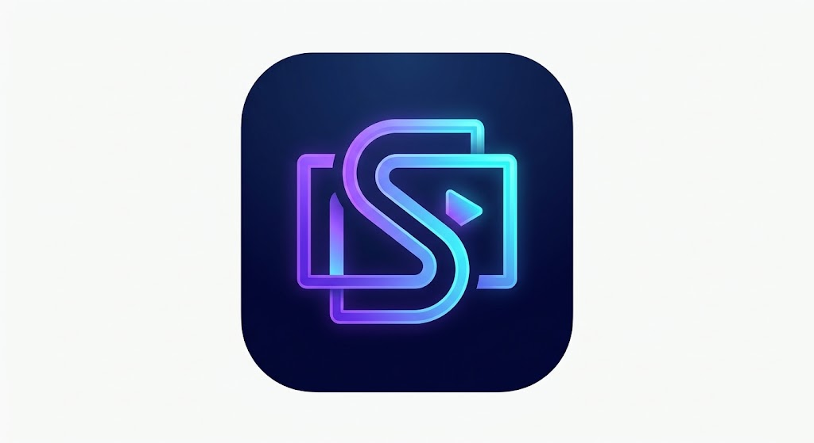

  

<h1 align="center">Seriolab</h1>

  <strong>Your minimalist, social TV show & anime tracking application.</strong>

  
  
  
  

---

## 🧪 About Seriolab

**Seriolab** is a cinematic, minimalist tracking experience crafted for TV binge-watchers, series lovers, and anime fans. Inspired by the clean aesthetics of platforms like Letterboxd, Seriolab connects you to the global television catalog while offering rich social features, granular episode progress logging, and visual watch statistics.

---

## ✨ Key Features

- **🎬 Comprehensive Catalog & TMDB Integration:**
  - Rich synopses, production metadata, full cast lists, and official YouTube trailers streamed directly inside the app with zero ads.
  - Up-to-date data on upcoming seasons, episodes, and broadcast air dates.

- **⏱️ Episode Logging & Recent Activity:**
  - Effortless tracking per episode or entire season batch-marking.
  - Chronological recent activity history with precise tie-breaking by watch timestamp, season number, and episode number.

- **⭐️ Ratings & Top 5 Favorites:**
  - Granular star ratings from 0.5 to 10 for any show or individual episode.
  - Visual *Ratings Breakdown* bar chart.
  - Showcase your personal **TOP 5** favorite series on your public profile.

- **👥 Social Community & Profiles:**
  - Public user profiles with custom avatars, banners, and biographies.
  - Follow system (*Following* / *Followers*).
  - Episode reviews and comments with **Spoiler** protection tags, community discussions, and report/flagging moderation.

- **🗓️ Smart Schedule & Calendar:**
  - **Currently Watching:** Shows actively in your watchlist that have unaired or unwatched episodes ready to enjoy.
  - **Coming Soon:** Upcoming premieres and new seasons of shows you follow or plan to watch.

- **🔬 Distinctive Visual Identity:**
  - Immersive dark theme (*Midnight Indigo & Electric Violet* - `#0D0F17` and `#7C5CFC`).
  - Custom vector-animated beaker loader and pull-to-refresh widgets designed specifically for Seriolab.

---

## 📲 Step-by-Step Installation Guide (Android)

Follow these simple steps to install Seriolab on your Android device via APK:

1. **Visit Releases:**
   - Go directly to the [Latest Seriolab GitHub Release](https://github.com/TheMoita/seriolab/releases/latest).

2. **Download the APK:**
   - Under the **Assets** section of the release, tap the file named `seriolab-vX.X.X.apk` to begin downloading.

3. **Allow Unknown Sources:**
   - Once the download is complete, open the file from your download notification or File Manager app.
   - If prompted by Android, enable **"Install unknown apps"** (or *"Allow from this source"*) for your browser or file manager.

4. **Install & Launch:**
   - Tap **Install**. Once the installation finishes, tap **Open**, sign in with your account, and start tracking your shows!

---

## 🔄 How to Update the App

Seriolab includes a built-in **In-App Update Checker**:

- **Automatic Check on Launch:** Whenever a new version is released on GitHub, a discreet bottom sheet will appear upon opening the app, allowing you to trigger the download by tapping **"Atualizar Agora" / "Update Now"**.
- **Manual Check:** Go to **Profile** ➔ **Settings (gear icon)** ➔ **About & Version** and tap **"Verificar Atualizações"**.
- **Direct APK Upgrade:** You can always download the latest APK file directly from [Releases](https://github.com/TheMoita/seriolab/releases/latest) and install it over your existing installation. **There is no need to uninstall the previous version** — all your accounts, logged episodes, and preferences remain safe and untouched.

---

## 🛠️ Built With

- **[Flutter](https://flutter.dev/) & [Dart](https://dart.dev/):** High-performance cross-platform application framework.
- **[Flutter Riverpod](https://riverpod.dev/):** Reactive, testable, and robust state management.
- **[Firebase Authentication](https://firebase.google.com/products/auth) & [Cloud Firestore](https://firebase.google.com/products/firestore):** Real-time cloud sync and secure authentication.
- **[SQLite (sqflite)](https://pub.dev/packages/sqflite):** Ultra-fast local database and offline cache.
- **[The Movie Database (TMDB) API](https://www.themoviedb.org/documentation/api):** Global television metadata, high-resolution artwork, and episode data.
- **[GitHub Actions](https://github.com/features/actions):** Continuous Integration & Deployment (CI/CD) automatically compiling and publishing release APKs.

---

## 🛡️ Privacy & Data Ownership

- Seriolab is designed with privacy at its core: no invasive third-party ad tracking or behavioral ad networks.
- Your watch progress and library data can be synced to your private Firebase account or exported anytime in JSON and CSV format directly through the Settings screen.

---

## 📄 License & Acknowledgments

- This project is open-source under the [MIT License](LICENSE).
- This product uses the TMDB API but is not endorsed or certified by TMDB.
